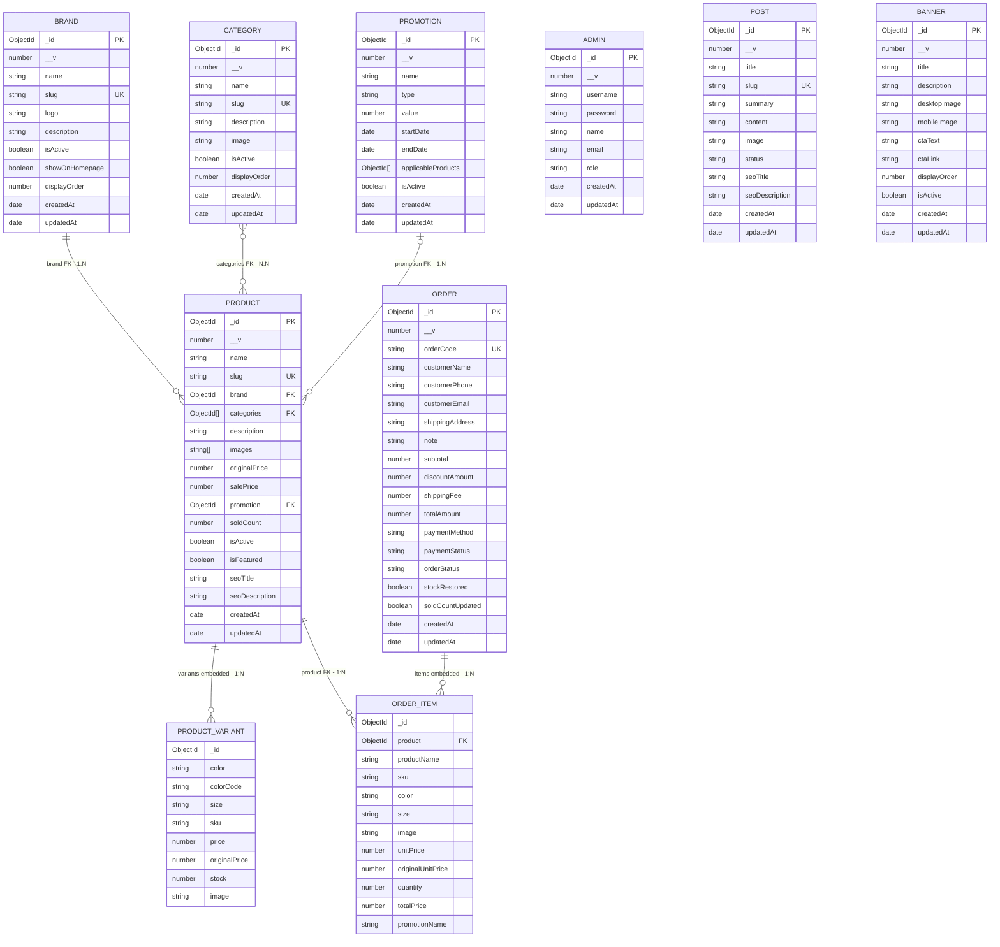

# ERD cơ sở dữ liệu PERY SPORT

Sơ đồ này được dựng bằng cách đọc trực tiếp cấu trúc document trong MongoDB Atlas,
database `pery_sport`, vào ngày 2026-10-15. Các giá trị dữ liệu không được đưa vào
tài liệu. File Mermaid độc lập để xuất ảnh: [database-erd.mmd](./database-erd.mmd).

Kết quả introspection hiện tại gồm 9 collection:

| Collection | Số document |
|---|---:|
| `admins` | 1 |
| `banners` | 3 |
| `brands` | 5 |
| `categories` | 5 |
| `orders` | 1 |
| `posts` | 5 |
| `products` | 20 |
| `promotions` | 2 |

Các collection hiện có được kiểm tra toàn bộ document (42 document). Số lượng
document có thể thay đổi sau khi dữ liệu trên Atlas được cập nhật.

Các tham chiếu ObjectId được đối chiếu với `_id` của collection đích: 20 sản phẩm
tham chiếu thương hiệu, 29 tham chiếu danh mục từ sản phẩm, 12 tham chiếu
khuyến mãi từ sản phẩm và 2 dòng hàng đơn tham chiếu sản phẩm. Các tham chiếu
được kiểm tra đều khớp document đích.

## Cách đọc sơ đồ

- `PK`: khóa chính của document; `UK`: field có unique index thực tế trên Atlas;
  `FK`: ObjectId tham chiếu đến document khác.
- Ở mỗi đầu đường nối, `||` nghĩa là đúng một, `o|` là không hoặc một, `|{` là
  một hoặc nhiều, và `o{` là không hoặc nhiều.
- Vì vậy `||--o{` là một-nhiều (1:N), `}o--o{` là nhiều-nhiều (N:N), còn
  `||--||` biểu diễn một-một (1:1). Dữ liệu Atlas hiện tại không có quan hệ
  1:1 nên không có đường nối `||--||`.
- `categories` là mảng ObjectId tham chiếu từ sản phẩm đến danh mục.
  `applicableProducts` tồn tại trong `promotions`, nhưng hiện rỗng trong cả hai
  document khuyến mãi nên không có cạnh N:N nào được quan sát từ trường này.

## Ghi chú

- Ảnh PNG đã xuất sẵn tại [database-erd.png](./database-erd.png). Nếu cần xuất
  lại hoặc lưu thành PNG/JPG, mở [Mermaid Live Editor](https://mermaid.live), dán
  toàn bộ nội dung trong [database-erd.mmd](./database-erd.mmd) vào khung code,
  chờ sơ đồ hiển thị, rồi chọn **Actions → Export PNG** hoặc
  **Actions → Export SVG**.
  Nếu cần JPG, mở PNG vừa xuất và dùng chức năng **Save as/Export** của ứng dụng
  ảnh để lưu JPG; PNG thường rõ hơn cho sơ đồ có chữ.
- Có thể xem sơ đồ trực tiếp trên GitHub bằng file Markdown này, hoặc cài
  extension Mermaid trong VS Code rồi dùng **Markdown: Open Preview**.
- `PRODUCT_VARIANT` và `ORDER_ITEM` là subdocument nhúng trong document cha; chúng
  không phải collection độc lập. `_id` trong hai entity này là ID subdocument do
  Mongoose mặc định tạo, không phải khóa chính của collection riêng.
- Quan hệ `PRODUCT`–`PROMOTION` đang được quan sát qua ObjectId `Product.promotion`.
  Trường `Promotion.applicableProducts` có tồn tại nhưng mảng rỗng ở toàn bộ
  document trên Atlas hiện tại nên không được vẽ thành một quan hệ đang sử dụng.
- `ORDER_ITEM.product` tham chiếu đến `PRODUCT`, nhưng các trường tên sản phẩm,
  SKU, biến thể, ảnh và giá cũng được lưu snapshot tại thời điểm đặt hàng.
- `ORDER` lưu thông tin khách hàng trực tiếp (`customerName`, `customerPhone`,
  `customerEmail`, `shippingAddress`), không có `userId`. Atlas hiện không có
  collection `users`.
- MongoDB dùng document thay vì khóa ngoại bắt buộc. Ký hiệu `FK` trong sơ đồ
  biểu thị ObjectId được đối chiếu khớp với `_id` của collection đích trong dữ
  liệu đang có; MongoDB không tự thực thi ràng buộc khóa ngoại.
- Các unique index xác nhận trực tiếp từ Atlas: `brands.slug`, `categories.slug`,
  `products.slug`, `posts.slug` và `orders.orderCode`. Không đánh dấu
  `admins.username` là `UK` vì collection hiện không có unique index cho field đó.
- Các collection độc lập hiện có trên Atlas: `admins`, `banners`, `posts`.
- Không có quan hệ 1:1 được quan sát trong dữ liệu Atlas hiện tại.
